<picture>
  <source media="(prefers-reduced-motion: reduce) and (prefers-color-scheme: dark)" srcset="raid/raid-dark-static.svg">
  <source media="(prefers-reduced-motion: reduce)" srcset="raid/raid-light-static.svg">
  <source media="(prefers-color-scheme: dark)" srcset="raid/raid-dark.svg">
  <source media="(prefers-color-scheme: light)" srcset="raid/raid-light.svg">
  
</picture>
